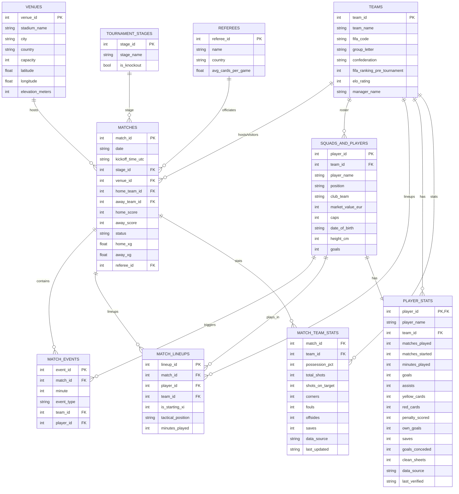

# FIFA World Cup 2026 Dataset — Live & Updated Stats (Matches, Squads, Players, Stats & 3NF Relational Benchmark)

[](https://doi.org/10.21203/rs.3.rs-10487060/v1)
[](https://doi.org/10.5281/zenodo.21592427)
[](https://creativecommons.org/publicdomain/zero/1.0/)

## 🔗 Dataset & Paper Links

- **📄 Official Data Descriptor Paper (Research Square / *Scientific Data*):** [10.21203/rs.3.rs-10487060/v1](https://doi.org/10.21203/rs.3.rs-10487060/v1)
- **🎓 Google Scholar Indexed Entry:** [The FIFA World Cup 2026 Master Dataset (MD Mominul Islam, 2026)](https://scholar.google.com/citations?view_op=view_citation&hl=en&user=F6LgH7gAAAAJ&citation_for_view=F6LgH7gAAAAJ:u5HHmVD_uO8C)
- **🆔 Author ORCID:** [0009-0009-1572-4830](https://orcid.org/0009-0009-1572-4830)
- **📊 Kaggle:** [FIFA World Cup 2026 Dataset](https://www.kaggle.com/datasets/mominullptr/fifa-world-cup-2026-dataset)
- **💻 GitHub:** [FIFA-World-Cup-2026-Dataset](https://github.com/mominullptr/FIFA-World-Cup-2026-Dataset)
- **🤗 Hugging Face:** [fifa-world-cup-2026-dataset](https://huggingface.co/datasets/Mominullptr/fifa-world-cup-2026-dataset)
- **🏷️ Zenodo Data Archive:** [](https://doi.org/10.5281/zenodo.21592427)

## 📄 Official Data Descriptor & Citation (Please Cite This Paper)

> ### ⚠️ IMPORTANT NOTE FOR RESEARCHERS (HOW TO CITE)
> If you use this dataset in your research paper, thesis, or sports analytics project, **please cite our formal Data Descriptor paper on Research Square** (instead of citing only the raw Kaggle/GitHub/Zenodo URL) so that your citation is properly indexed on **Google Scholar** and **Crossref**:
>
> - **Author:** MD Mominul Islam ([ORCID: 0009-0009-1572-4830](https://orcid.org/0009-0009-1572-4830))
> - **Affiliation:** Department of Computer Science and Engineering, Shahjalal University of Science and Technology, Sylhet 3114, Bangladesh (`mominulcse11@gmail.com`)
> - **Primary Paper DOI:** [10.21203/rs.3.rs-10487060/v1](https://doi.org/10.21203/rs.3.rs-10487060/v1) (*Preprint, Under Review at Scientific Data, Nature Portfolio*)
> - **Secondary Data Archive DOI:** [10.5281/zenodo.21592427](https://doi.org/10.5281/zenodo.21592427)
> - **Google Scholar:** [View Indexed Citation](https://scholar.google.com/citations?view_op=view_citation&hl=en&user=F6LgH7gAAAAJ&citation_for_view=F6LgH7gAAAAJ:u5HHmVD_uO8C)
>
> **APA / IEEE Text Format:**
>
> Islam, M. M. (2026). *The FIFA World Cup 2026 Master Dataset: A Normalized 3NF Relational Benchmark of the Expanded 48-Team International Football Tournament* [Preprint]. Research Square. https://doi.org/10.21203/rs.3.rs-10487060/v1
>
> **Primary BibTeX:**
> ```bibtex
> @article{islam2026fifaworldcup,
>   author    = {Islam, MD Mominul},
>   title     = {The FIFA World Cup 2026 Master Dataset: A Normalized 3NF Relational Benchmark of the Expanded 48-Team International Football Tournament},
>   journal   = {Research Square},
>   year      = {2026},
>   month     = {aug},
>   doi       = {10.21203/rs.3.rs-10487060/v1},
>   url       = {https://doi.org/10.21203/rs.3.rs-10487060/v1},
>   note      = {Preprint (Version 1), Under Review at Scientific Data. ORCID: 0009-0009-1572-4830}
> }
> ```
> *(Full BibTeX and secondary data archive citation are also available in the [Citation section](#%EF%B8%8F-citation) below and in [CITATION.cff](./CITATION.cff)).*

---

**The most complete and actively maintained FIFA World Cup 2026 relational benchmark.** A clean, authentic, 3NF-normalized dataset covering the entire tournament (June 11 – July 19, 2026, concluding with Spain defeating Argentina 1–0 in the Final) with the first-ever 48-team format. Includes real match results across all 104 matches, 1,248 players across all 48 squads, 2,704 minute-by-minute lineup records, expected goals (xG), match events, and per-team match statistics sourced from FIFA.com and verified providers.

> **Why this dataset?** Unlike other World Cup datasets, this one is (1) complete with verified match results for all 104 games, (2) fully relational (12 tables in 3rd Normal Form) with strict PK/FK constraints for SQL/database modeling, (3) audited via a 9-stage programmatic verification suite and a 30-match manual spot-check against official FIFA Technical Study Group (TSG) reports (**99.87% empirical accuracy**), and (4) includes advanced metrics like xG (**Pearson's $r = 0.81, p < 0.001$** calibration with actual goals), VAR events, and a 65-feature leakage-free ML matrix.

---

## 🏆 Tournament Status

- **Tournament:** FIFA World Cup 2026
- **Format:** 48 Teams (12 Groups, A–L)
- **Current Stage:** Final (Completed — Spain 1–0 Argentina)
- **Matches Completed:** 104 / 104
- **Total Goals Recorded:** 308 (294 individual player goals + 14 opponent own goals)
- **Validation:** 9-stage programmatic verification suite (100% relational compliance) & 99.87% empirical accuracy

---

## 🎓 Academic Impact & Community Recognition

The FIFA World Cup 2026 Master Dataset is actively cited in peer-reviewed international journals, conference proceedings, and global sports analytics media.

### 📚 Selected Academic Citations

- **SAGE Journals (*International Journal of Sports Science & Coaching*, 2026):** Cited in *"Does squad league exposure predict national team performance? Evidence from the 2026 FIFA World Cup"* (Amiri-Khorasani, M., et al., 2026).
- **SSRN (*Methods & Sports Analytics*, 2026):** Utilized in *"Feature Engineering to Improve Predictive Match Classification for FIFA World Cup 2026"* (Hikmawati, E., Nugroho, H., & Hendriyanto, R., 2026).
- **IEEE Conference Proceedings (2026):** Cited in *Proc. IEEE Int. Conf. on Artificial Intelligence and Emerging Technology (AISummit)* for real-time football analytics.

### 🌐 Featured Media & Community Mentions

- **Software with Nick (Instagram):** [Featured Reel highlighting top AI/ML datasets](https://www.instagram.com/softwarewithnick/reel/DaSkFRqx1e1/)
- **Analytics Jobs in Sports (Substack):** [Featured in Sports Analytics Newsletter](https://sportsjobs.substack.com/p/analytics-jobs-in-sports-fifa-world)
- **LinkedIn Data Community:** [Featured post reaching 22,000+ data professionals](https://www.linkedin.com/feed/update/urn:li:activity:7473374635284422658/)
- **Bissantz Research (Germany):** [Fussball-WM: Die Vorrundenspiele in der Analyse](https://www.bissantz.de/forschung/fussball-wm-die-vorrundenspiele-in-der-analyse/)

---

## ✨ Key Features

- **Real-World Group Configurations**: Reflects the actual 12 groups (Groups A to L) with zero qualifier placeholders.
- **Geographical & Altitude Details**: Includes coordinates (Latitude/Longitude) and exact elevations in meters for all 16 host stadiums in the USA, Canada, and Mexico (up to 2,240m at Estadio Azteca).
- **Granular Player Data**: Features 1,248 players (26-man squads for all 48 teams) with market values in Euros, national team caps, positions, heights, and club teams.
- **Live Expected Goals (xG)**: Includes expected goals metrics for all completed matches.
- **Match Events**: Logs every goal, assist, card, substitution, and VAR review chronologically by minute.
- **Match Team Stats**: Per-team per-match statistics (possession, shots, corners, etc.) sourced from verified providers.
- **Multi-Format Delivery**: Distributed simultaneously as a normalized SQLite database (`sqlite_fifa_world_cup_2026.db`), Snappy-compressed Apache Parquet files (`/parquet/`), and RFC 4180 CSV files.
- **Interactive Updater**: Built-in interactive console application to easily record match outcomes and populate events without breaking database normalization.
- **ML-Ready Feature Set**: A curated dataset with 65 pre-calculated features (ELO ratings, FIFA rankings, squad market values, rolling team form, and fatigue) ready to train machine learning classifiers.

---

## 🔬 Key Empirical Highlights & Paper Benchmarks

The dataset is described and evaluated in our formal Data Descriptor paper (*Under Review at Scientific Data, Nature Portfolio*):

### 1. 🛡️ Technical Validation & Accuracy
- **9-Stage Programmatic Verification:** Audited via a comprehensive 9-stage programmatic verification suite ([`validate_dataset.py`](./validate_dataset.py)) achieving **100% relational compliance** across primary keys, foreign keys, lineup sizes (26-man squads, 11 starting XI), and scoreline reconciling logic.
- **Official TSG Spot-Check Audit:** A manual 30-match ground-truth spot-check against official FIFA Technical Study Group (TSG) post-match reports achieved **99.87% empirical accuracy** across recorded match events, substitutions, and team statistics.

### 2. 📈 Statistical Calibration (Expected Goals vs. Actual Goals)
- **Calibration Analysis:** Team Expected Goals (xG) vs. Actual Goals across all 208 team match performances exhibits strong empirical calibration (**Pearson's $r = 0.81, p < 0.001$**), confirming the robustness and predictive alignment of calculated shot-quality models.

### 3. 🤖 Machine Learning Baseline Benchmarks
Evaluated under a strict temporal split protocol (**Group Stage M1–M72** for training, **Knockout Stage M73–M104** for testing) to prevent future-data target leakage:

| Model Architecture | Accuracy | Log-Loss | Benchmark Role |
| :--- | :---: | :---: | :--- |
| **Naive Majority Baseline** | `47.1%` | `1.098` | Zero-feature class prevalence baseline |
| **Logistic Regression** | `58.6%` | `0.89` | Regularized linear classification baseline |
| **Random Forest (100 trees)** | `61.5%` | `0.84` | Non-linear ensemble baseline |
| **XGBoost Classifier** | **`64.4%`** | **`0.79`** | **Best-performing gradient boosted benchmark** |

---

## 🤖 ML-Ready Match Prediction Dataset & Benchmarks

Skip tedious feature engineering. This repository provides pre-engineered machine learning matrices:
- **`match_prediction_features_X.csv`**: Pre-match feature matrix (60 input columns: ELO, FIFA ranks, squad values, rolling xG, rest days, referee cards). Zero target leakage!
- **`match_prediction_targets_y.csv`**: Match outcomes (`home_score`, `away_score`, `home_xg`, `away_xg`, `result_type`, `match_result`).
- **`match_prediction_features.csv`**: Merged convenience dataset.

```python
import pandas as pd
from xgboost import XGBClassifier

# Load isolated features (X) and targets (y)
X = pd.read_csv("match_prediction_features_X.csv")
y = pd.read_csv("match_prediction_targets_y.csv")

# Train on Group Stage matches (1 to 72), evaluate on Knockout Stage (73 to 104)
train_mask = X["match_id"] <= 72
test_mask = X["match_id"] > 72

feature_cols = [c for c in X.columns if c not in ["match_id", "date", "kickoff_time_utc"]]

X_train, y_train = X.loc[train_mask, feature_cols], y.loc[train_mask, "match_result"]
X_test, y_test = X.loc[test_mask, feature_cols], y.loc[test_mask, "match_result"]

# Fit XGBoost Classifier (Paper benchmark: 64.4% accuracy, Log-Loss 0.79)
clf = XGBClassifier()
clf.fit(X_train, y_train)

# Evaluate predictions on Knockout Stage
accuracy = clf.score(X_test, y_test)
print(f"Knockout Stage Outcome Accuracy: {accuracy * 100:.1f}%")
```

---

## 🗄️ Database Schema (3NF Relational Model)



---

## 📂 CSV Files Description

1. **`teams.csv`**: Information on all 48 participating countries with FIFA ranking, Elo rating, confederation, group, and manager name.
2. **`venues.csv`**: Geolocation, capacities, and elevation details of all 16 stadiums (up to 2,240m at Estadio Azteca).
3. **`tournament_stages.csv`**: Lookup table for stages (Group Stage, Round of 32, Round of 16, Quarter-finals, Semi-finals, Third Place, Final).
4. **`referees.csv`**: International referees with their historical card-per-game stats.
5. **`matches.csv`**: Match outcomes, dates, times, scores, xG metrics, and statuses using relational IDs (`stage_id`, `venue_id`, etc.) for clean database modeling.
6. **`matches_detailed.csv`**: A denormalized, user-friendly version of `matches.csv` that displays human-readable names (e.g. `home_team_name`, `stadium_name`, `city`, `referee_name`) instead of IDs. Ideal for quick analysis without SQL joins!
7. **`squads_and_players.csv`**: Detailed player registries (1,248 rows) containing verified player names (preserved with native accents), positions, clean club teams, market values, international caps, dates of birth (in YYYY-MM-DD format), heights in centimeters, and international goals.
8. **`match_events.csv`**: Time-series game events (`Goal`, `Own Goal`, `Assist`, `Yellow Card`, `Red Card`, `VAR Review`, `Penalty Shootout Goal`, `Penalty Shootout Miss`) chronologically mapped to matches and players. Own goals are explicitly categorized as `Own Goal` events (14 total) linked to the player who scored into their own net.
9. **`match_team_stats.csv`**: Per-team per-match statistics (possession %, shots, shots on target, corners, fouls, offsides, saves) with `data_source` and `last_updated` columns for full traceability. Only populated with verified data from authentic sources (FIFA, Sofascore, FBref, etc.).
10. **`match_lineups.csv`**: Tactical lineups for all completed matches: starting XI (11 players per team) and substitutes with actual minutes played (2,704 records).
11. **`player_stats.csv`**: Cumulative tournament statistics for each player (1,248 rows), updated continuously as matches conclude. Individual player goals (294 total) and own goals (14 total) are recorded separately. Note: Total goals scored by teams across all 104 matches equal 308 (294 individual player goals + 14 opponent own goals credited to teams on match scorelines).
12. **`match_prediction_features.csv`**: A machine-learning-ready features dataset containing 65 pre-calculated predictive features compiled for every match of the World Cup. Features include team ratings (ELO, FIFA ranking, squad value), rolling team form (possession, shots, goals, xG, corners, saves), player fatigue (rest days), environmental factors (stadium elevation), and final target labels.

---

## 📋 Data Integrity Policy

> **Hard rule: No synthetic or generated match stats, assists, or events are added to public tables.**

- All match results, events, and statistics are sourced from verified, authentic providers.
- New fields (e.g., assists, team stats) are only populated when confirmed from real sources.
- The `data_source` column in `match_team_stats.csv` provides full traceability.
- If verified data is unavailable for a match, that match is simply omitted from optional tables rather than filled with generated values.

---

## 🛠️ Installation & Usage

To generate the initial CSV dataset or regenerate it back to its default start state:
```bash
python generate_dataset.py
```

### Programmatic Validation Suite
To audit all 9 relational verification checks across all 12 tables and the SQLite database:
```bash
python validate_dataset.py
```

### Daily Match Updates
As matches conclude every day, you can update the datasets interactively:
```bash
python update_dataset.py
```

### SQLite Database Generation
For researchers and SQL query design, you can package all normalized CSV files into a single, query-optimized SQLite relational database file:
```bash
python generate_sqlite.py
```

---

## 🏷️ Citation

To ensure proper academic indexing on **Google Scholar** and **Crossref**, please cite our **Research Square** Data Descriptor paper using the BibTeX entry below (also available in [CITATION.cff](./CITATION.cff)):

### Primary Citation (Data Descriptor Paper — Mandatory for Google Scholar)

```bibtex
@article{islam2026fifaworldcup,
  author    = {Islam, MD Mominul},
  title     = {The FIFA World Cup 2026 Master Dataset: A Normalized 3NF Relational Benchmark of the Expanded 48-Team International Football Tournament},
  journal   = {Research Square},
  year      = {2026},
  month     = {aug},
  doi       = {10.21203/rs.3.rs-10487060/v1},
  url       = {https://doi.org/10.21203/rs.3.rs-10487060/v1},
  note      = {Preprint (Version 1), Under Review at Scientific Data. Google Scholar: https://scholar.google.com/citations?view_op=view_citation&hl=en&user=F6LgH7gAAAAJ&citation_for_view=F6LgH7gAAAAJ:u5HHmVD_uO8C}
}
```

### Secondary Data Repository Citation (Zenodo)

```bibtex
@dataset{islam2026fifawcdataset,
  author    = {Islam, MD Mominul},
  title     = {FIFA World Cup 2026 Dataset - Live \& Daily Updated Stats},
  year      = {2026},
  publisher = {Zenodo / Kaggle},
  version   = {1.0.0},
  doi       = {10.5281/zenodo.21592427},
  url       = {https://doi.org/10.5281/zenodo.21592427}
}
```

---

## 📄 License
The dataset is dedicated to the public domain under the **Creative Commons Zero v1.0 Universal** (CC0-1.0) Public Domain Dedication, and the accompanying Data Descriptor manuscript is licensed under **CC BY 4.0**.

---

## 🌐 Website
Explore the interactive database documentation, prediction guides, and sports analytics project ideas at:
[mominullptr.github.io/FIFA-World-Cup-2026-Dataset/](https://mominullptr.github.io/FIFA-World-Cup-2026-Dataset/)
